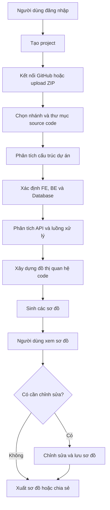
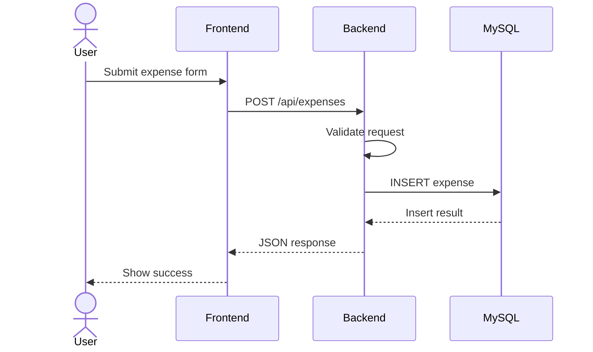
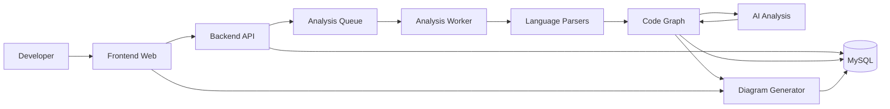

# ĐẶC TẢ NGHIỆP VỤ
## CodeFlow – Web tạo sơ đồ kiến trúc và luồng xử lý từ source code

**Phiên bản:** 1.0  
**Loại sản phẩm:** Web application / Developer tool  
**Đối tượng sử dụng:** Backend Developer, Frontend Developer, Fullstack Developer, Tech Lead  
**Mục tiêu:** Giúp developer hiểu, phân tích và tài liệu hóa luồng xử lý của một dự án phần mềm mà không phải đọc thủ công toàn bộ source code.

---

# 1. Tổng quan sản phẩm

## 1.1. Bài toán

Trong quá trình phát triển phần mềm, developer thường phải đọc nhiều file code để hiểu một chức năng hoạt động như thế nào.

Ví dụ, khi cần hiểu chức năng tạo đơn hàng, developer phải lần theo:

- Frontend: Component → Form → API client.
- Backend: Route → Controller → Service → Repository/Model.
- Database: Query → Table → Relationship.
- Response: Backend trả dữ liệu về Frontend và cập nhật giao diện.

Việc này mất nhiều thời gian, đặc biệt khi tiếp nhận dự án mới, review code, debug lỗi hoặc bàn giao cho developer khác.

## 1.2. Giải pháp

CodeFlow là một web app cho phép người dùng kết nối hoặc tải source code của dự án lên để hệ thống tự động:

1. Phân tích cấu trúc dự án FE, BE và MySQL.
2. Xác định các thành phần liên quan đến nhau.
3. Truy vết luồng xử lý từ giao diện đến database.
4. Sinh sơ đồ dựa trên code thực tế.
5. Cho phép developer chỉnh sửa, lưu trữ và xuất sơ đồ.
6. Cập nhật sơ đồ khi source code thay đổi.

Sản phẩm không chỉ tạo sơ đồ từ mô tả văn bản mà phải ưu tiên **truy xuất được sơ đồ về file và dòng code nguồn** để developer kiểm chứng.

## 1.3. Giá trị cốt lõi

- Giảm thời gian tìm hiểu codebase.
- Hỗ trợ onboarding developer mới.
- Hỗ trợ debug và review code.
- Tạo tài liệu kỹ thuật từ source code.
- Giúp developer hiểu mối quan hệ giữa FE, BE và database.

---

# 2. Phạm vi sản phẩm

## 2.1. Phạm vi MVP

MVP tập trung vào dự án web có cấu trúc:

| Thành phần | Công nghệ hỗ trợ ban đầu |
|---|---|
| Frontend | Vue.js, Nuxt.js, React |
| Backend | PHP Laravel, Node.js/NestJS |
| Database | MySQL, MariaDB |
| API | REST API |
| Source code | GitHub repository hoặc ZIP |
| Sơ đồ | Flowchart, Sequence Diagram, ERD |

MVP ưu tiên Laravel + Vue/Nuxt + MySQL vì đây là nhóm công nghệ phổ biến và có thể mở rộng parser theo từng framework.

## 2.2. Ngoài phạm vi MVP

- Phân tích mọi ngôn ngữ lập trình.
- Tự động sửa code hoặc refactor code.
- Tự động thực thi source code của người dùng.
- Phân tích chính xác mọi luồng xử lý động tại runtime.
- Tạo sơ đồ từ các hệ thống phân tán phức tạp.
- Thay thế IDE hoặc công cụ quản lý database.

Các chức năng này có thể được xem xét ở những phiên bản sau.

---

# 3. Đối tượng sử dụng

## 3.1. Developer

Có thể tạo project, phân tích code, xem sơ đồ, chỉnh sửa và xuất sơ đồ.

## 3.2. Tech Lead

Có thể dùng sơ đồ để review kiến trúc, kiểm tra luồng xử lý và bàn giao dự án.

## 3.3. Project Owner

Có thể quản lý project và phân quyền thành viên trong các phiên bản có hỗ trợ team.

## 3.4. Admin hệ thống

Quản lý người dùng, giới hạn sử dụng, dung lượng source code và các tác vụ phân tích.

---

# 4. Luồng nghiệp vụ tổng thể



**Nguyên tắc:** Mỗi sơ đồ phải được sinh từ kết quả phân tích source code. AI có thể hỗ trợ giải thích hoặc suy luận, nhưng không được tự ý khẳng định những quan hệ chưa có bằng chứng trong code.

---

# 5. Các chức năng nghiệp vụ

## 5.1. Quản lý project

### Mục tiêu

Cho phép người dùng quản lý các dự án source code cần phân tích.

### Chức năng

- Tạo project.
- Xem danh sách project.
- Xem chi tiết project.
- Chỉnh sửa thông tin project.
- Xóa project.
- Quản lý các lần phân tích.
- Quản lý danh sách sơ đồ của project.

### Thông tin project

| Trường | Mô tả |
|---|---|
| Project name | Tên dự án |
| Description | Mô tả |
| Source type | GitHub hoặc ZIP |
| Repository URL | Địa chỉ repository nếu dùng GitHub |
| Default branch | Nhánh mặc định |
| Main languages | Ngôn ngữ được phát hiện |
| Created at | Ngày tạo |
| Last analyzed at | Lần phân tích gần nhất |

### Quy tắc nghiệp vụ

- Project phải thuộc về một người dùng hoặc một workspace.
- Mỗi project có thể có nhiều lần phân tích.
- Một lần phân tích phải gắn với một phiên bản source code cụ thể.
- Khi source code thay đổi, hệ thống không tự ghi đè các sơ đồ cũ.
- Người dùng có thể chọn một lần phân tích cũ để xem lại sơ đồ.

---

## 5.2. Kết nối source code

### Mục tiêu

Cho phép người dùng cung cấp source code để hệ thống phân tích.

### Phương thức 1: Kết nối GitHub

Người dùng thực hiện:

1. Chọn kết nối GitHub.
2. Cấp quyền truy cập repository.
3. Chọn repository.
4. Chọn branch hoặc commit.
5. Chọn thư mục cần phân tích.
6. Xác nhận bắt đầu phân tích.

Hệ thống chỉ được truy cập repository mà người dùng đã cấp quyền.

### Phương thức 2: Upload ZIP

Người dùng thực hiện:

1. Chọn file ZIP.
2. Hệ thống kiểm tra định dạng và dung lượng.
3. Người dùng chọn thư mục gốc.
4. Xác nhận bắt đầu phân tích.

### Quy tắc nghiệp vụ

- Không yêu cầu người dùng nhập thông tin database production.
- Không tự động chạy source code của người dùng.
- Loại bỏ các thư mục không cần phân tích như `node_modules`, `vendor`, `dist`, `.git`.
- Bỏ qua file binary và file vượt quá giới hạn.
- Không đọc các file `.env`, private key, credential hoặc secret để đưa vào AI.
- Người dùng phải xác nhận quyền truy cập trước khi hệ thống lấy source code.
- Mỗi lần phân tích phải lưu lại commit SHA hoặc mã phiên bản source code.

---

## 5.3. Phân tích cấu trúc source code

### Mục tiêu

Tự động xác định các thành phần chính của dự án.

### Thông tin cần phân tích

- Ngôn ngữ lập trình.
- Framework.
- Cấu trúc thư mục.
- API endpoints.
- Controller.
- Service.
- Repository hoặc Model.
- Component.
- Page.
- API client.
- Database tables.
- Database relationships.
- Các file cấu hình liên quan.

### Ví dụ kết quả phân tích

```text
Project: ShareSpend

Frontend:
  app/pages/expenses/index.vue
  app/components/ExpenseForm.vue
  app/composables/useExpense.ts

Backend:
  routes/api.php
  app/Http/Controllers/ExpenseController.php
  app/Services/ExpenseService.php
  app/Models/Expense.php

Database:
  expenses
  groups
  group_members
  users
```

### Quy tắc nghiệp vụ

- Hệ thống phải phân biệt được dữ liệu đã xác định từ source code và dữ liệu suy luận.
- Không được tạo quan hệ giữa hai file chỉ vì chúng có tên giống nhau.
- Mỗi thành phần được phân tích phải lưu được đường dẫn file.
- Nếu không xác định được framework, người dùng vẫn có thể xem cấu trúc file và tạo sơ đồ thủ công.

---

## 5.4. Phân tích luồng Frontend

### Mục tiêu

Xác định cách người dùng thao tác trên giao diện và cách dữ liệu được gửi đến Backend.

### Các bước phân tích

1. Xác định Page hoặc Route.
2. Xác định Component được sử dụng.
3. Xác định event hoặc action.
4. Xác định composable, hook hoặc state management.
5. Xác định API client được gọi.
6. Xác định endpoint và payload.
7. Xác định cách Frontend xử lý response.

### Ví dụ

```text
ExpensePage
    ↓
ExpenseForm
    ↓
onSubmit()
    ↓
useExpense()
    ↓
expenseApi.create()
    ↓
POST /api/expenses
```

### Kết quả cần lưu

- Tên component.
- File nguồn.
- Hàm xử lý.
- API được gọi.
- Payload được gửi.
- Cách xử lý response.
- Các nhánh điều kiện quan trọng.

---

## 5.5. Phân tích luồng Backend

### Mục tiêu

Xác định cách Backend xử lý request từ Frontend.

### Các bước phân tích

1. Xác định endpoint và HTTP method.
2. Xác định middleware và authentication.
3. Xác định Controller.
4. Xác định validation.
5. Xác định Service hoặc Business Logic.
6. Xác định Repository/Model/Query.
7. Xác định database operation.
8. Xác định response trả về Frontend.

### Ví dụ

```text
POST /api/expenses
    ↓
Auth Middleware
    ↓
ExpenseController@store
    ↓
ExpenseRequest Validation
    ↓
ExpenseService.create()
    ↓
Expense Model
    ↓
INSERT INTO expenses
    ↓
JSON Response
```

### Quy tắc nghiệp vụ

- Phải hỗ trợ trường hợp Controller gọi trực tiếp Model mà không có Service.
- Phải hỗ trợ một request gọi nhiều Service.
- Phải nhận diện transaction nếu có.
- Phải phân biệt xử lý đồng bộ và xử lý thông qua queue/job.
- Phải nhận diện các nhánh điều kiện có ảnh hưởng đến luồng xử lý.
- Nếu một lời gọi hàm không xác định được implementation, hiển thị trạng thái chưa xác định thay vì tự tạo luồng.

---

## 5.6. Phân tích Database MySQL

### Mục tiêu

Tạo sơ đồ cấu trúc dữ liệu và mối quan hệ giữa các bảng.

### Nguồn dữ liệu

- Migration files.
- SQL schema.
- ORM Model.
- Foreign key.
- Query trong source code.

### Thông tin cần xác định

- Tên bảng.
- Tên cột.
- Data type.
- Primary key.
- Foreign key.
- Unique constraint.
- Index.
- Relationship.
- Query CRUD được sử dụng.

### Ví dụ

```text
users
  id
  name
  email

expenses
  id
  user_id
  amount
  description
```

Quan hệ:

```text
users.id
    1
    |
    N
expenses.user_id
```

### Quy tắc nghiệp vụ

- Ưu tiên schema và foreign key thực tế.
- Nếu quan hệ chỉ được suy luận từ ORM hoặc query, phải đánh dấu là quan hệ suy luận.
- Không được tự tạo foreign key chỉ vì có cột `user_id`.
- Hỗ trợ các bảng không có foreign key.
- Không cần kết nối database production để sinh ERD từ migration hoặc schema.

---

# 6. Các loại sơ đồ

## 6.1. Flowchart – Sơ đồ luồng xử lý

Dùng để mô tả trình tự xử lý một chức năng.

Ví dụ: Tạo chi tiêu, đăng nhập, thanh toán, tạo đơn hàng.

Các thành phần:

- Start/End.
- Process.
- Condition.
- API Call.
- Database Operation.
- Error Handling.
- External Service.

Người dùng có thể chọn một chức năng để tạo sơ đồ riêng.

## 6.2. Sequence Diagram – Sơ đồ tuần tự

Dùng để thể hiện tương tác giữa các thành phần theo thời gian.

Ví dụ:



Sơ đồ phải thể hiện được request, response và các lời gọi nội bộ nếu xác định được.

## 6.3. ERD – Entity Relationship Diagram

Dùng để thể hiện cấu trúc và quan hệ giữa các bảng.

Có thể xem toàn bộ database hoặc chỉ các bảng liên quan đến một chức năng.

## 6.4. Component/Architecture Diagram

Dùng để thể hiện cấu trúc tổng thể của hệ thống.

Ví dụ:

```text
Frontend
  ├── Pages
  ├── Components
  └── API Client
         ↓
Backend
  ├── Routes
  ├── Controllers
  ├── Services
  └── Models
         ↓
Database
  ├── users
  ├── expenses
  └── groups
```

## 6.5. Data Flow Diagram

Dùng để thể hiện dữ liệu di chuyển giữa các thành phần.

Có thể chọn một loại dữ liệu để truy vết từ nơi được tạo, nơi được xử lý đến nơi được lưu trữ.

---

# 7. Chức năng tìm kiếm và truy vết code

Đây là chức năng quan trọng giúp sản phẩm khác biệt với các công cụ vẽ sơ đồ thông thường.

## 7.1. Tìm kiếm chức năng

Người dùng có thể nhập tên chức năng, ví dụ:

- Tạo chi tiêu.
- Đăng nhập.
- Xóa thành viên nhóm.
- Thanh toán đơn hàng.

Hệ thống tìm các file, API và database table liên quan.

## 7.2. Truy vết từ sơ đồ về code

Khi người dùng click vào một node trong sơ đồ, hệ thống hiển thị:

- Tên thành phần.
- File nguồn.
- Hàm hoặc method.
- Dòng code bắt đầu và kết thúc.
- Mô tả vai trò.
- Các node liên quan.

Nếu source code còn được lưu và có thể xem an toàn, người dùng có thể mở đoạn code tương ứng.

## 7.3. Truy vết từ code sang sơ đồ

Người dùng có thể tìm một file hoặc function trong project.

Hệ thống hiển thị:

- Các sơ đồ có chứa file/function.
- Các thành phần gọi đến nó.
- Các thành phần được nó gọi.
- Các API liên quan.
- Các bảng database liên quan.

---

# 8. Chỉnh sửa và quản lý sơ đồ

## 8.1. Chỉnh sửa sơ đồ

Người dùng có thể:

- Kéo thả node.
- Thay đổi vị trí.
- Thêm node thủ công.
- Thêm hoặc xóa connection.
- Sửa tên node.
- Sửa nội dung mô tả.
- Ẩn hoặc hiện node.
- Thay đổi hướng hiển thị.
- Undo/Redo.
- Lưu sơ đồ.

## 8.2. Quy tắc nghiệp vụ

- Sơ đồ được sinh tự động phải giữ thông tin nguồn code.
- Node được thêm thủ công phải được đánh dấu là node thủ công.
- Người dùng không được vô tình ghi đè kết quả phân tích gốc khi chỉnh sửa sơ đồ.
- Sơ đồ chỉnh sửa phải có khả năng lưu thành phiên bản riêng.
- Khi source code thay đổi, sơ đồ cũ vẫn được giữ lại.

---

# 9. Xuất và chia sẻ sơ đồ

Người dùng có thể:

- Export PNG.
- Export SVG.
- Export Mermaid.
- Export PlantUML.
- Export JSON sơ đồ.
- Chia sẻ sơ đồ bằng link.

Đối với link chia sẻ, hệ thống phải hỗ trợ quyền truy cập:

- Private: Chỉ chủ sở hữu hoặc thành viên được cấp quyền.
- Public: Bất kỳ ai có link đều xem được.

Mặc định tất cả sơ đồ phải ở chế độ Private.

---

# 10. Trạng thái phân tích

Mỗi lần phân tích có các trạng thái:

| Trạng thái | Ý nghĩa |
|---|---|
| Pending | Chờ xử lý |
| Processing | Đang phân tích |
| Completed | Phân tích thành công |
| Completed with warnings | Có kết quả nhưng một số thành phần chưa xác định |
| Failed | Phân tích thất bại |
| Cancelled | Người dùng đã hủy |

Hệ thống cần hiển thị tiến trình theo các giai đoạn:

1. Đọc source code.
2. Phân tích cấu trúc.
3. Phân tích API.
4. Phân tích database.
5. Xây dựng quan hệ code.
6. Sinh sơ đồ.

Nếu một bước thất bại, hệ thống cần hiển thị nguyên nhân và cho phép chạy lại khi phù hợp.

---

# 11. Quy tắc quan trọng về độ chính xác

## 11.1. Phân biệt dữ liệu thực tế và dữ liệu suy luận

Mỗi quan hệ trong sơ đồ cần có một trong các mức:

- Verified: Có bằng chứng trực tiếp từ code hoặc schema.
- Inferred: Được suy luận từ tên, cấu trúc hoặc quan hệ gián tiếp.
- Unknown: Chưa đủ thông tin để xác định.

Ví dụ:

Một API được xác định trực tiếp từ route và được gọi từ API client thì có thể đánh dấu Verified.

Nếu hệ thống chỉ suy luận một component có thể gọi API nào đó dựa trên tên hàm thì phải đánh dấu Inferred.

## 11.2. Không được bịa ra luồng xử lý

- Không tự thêm Service không tồn tại.
- Không tự tạo database table không tồn tại.
- Không tự tạo relationship khi chưa có bằng chứng.
- Không tự kết luận một function được gọi nếu chỉ có tên tương tự.
- Không tự kết luận luồng đã hoàn chỉnh khi thiếu implementation.

## 11.3. Xử lý code động

Một số trường hợp khó phân tích:

- Dynamic function call.
- Reflection.
- Dynamic import.
- Runtime-generated SQL.
- Event-driven architecture.
- Queue/job.
- External API.

Hệ thống phải đánh dấu các đoạn chưa xác định được và cho phép người dùng bổ sung thông tin thủ công.

---

# 12. Mô hình dữ liệu nghiệp vụ

Các entity chính:

## 12.1. User

Lưu thông tin người dùng.

## 12.2. Project

Lưu thông tin dự án.

## 12.3. ProjectSource

Lưu thông tin nguồn code và phiên bản source code.

## 12.4. AnalysisRun

Lưu từng lần phân tích.

## 12.5. CodeSymbol

Lưu các thành phần code đã phân tích.

Ví dụ: Function, Class, Method, Component, Endpoint, Database Table.

## 12.6. CodeRelation

Lưu quan hệ giữa các thành phần code.

Ví dụ: Calls, Imports, Renders, Requests, Reads, Writes.

## 12.7. Diagram

Lưu thông tin sơ đồ.

## 12.8. DiagramNode

Lưu các node trong sơ đồ.

## 12.9. DiagramEdge

Lưu các đường kết nối trong sơ đồ.

## 12.10. DiagramVersion

Lưu lịch sử phiên bản sơ đồ.

---

# 13. Mô hình kiến trúc đề xuất



## 13.1. Frontend

- Quản lý project.
- Upload source code.
- Xem tiến trình phân tích.
- Xem và chỉnh sửa sơ đồ.
- Tìm kiếm và truy vết code.

## 13.2. Backend

- Quản lý project.
- Quản lý source code.
- Điều phối quá trình phân tích.
- Quản lý dữ liệu code graph.
- Sinh và lưu sơ đồ.
- Quản lý quyền truy cập.

## 13.3. Analysis Worker

Thực hiện các tác vụ nặng:

- Giải nén source code.
- Phân tích syntax.
- Xây dựng code graph.
- Phân tích quan hệ.
- Sinh sơ đồ.

## 13.4. AI Analysis

AI chỉ hỗ trợ các công việc cần suy luận ngữ nghĩa:

- Giải thích function.
- Phân loại chức năng.
- Đề xuất mối quan hệ chưa rõ.
- Tóm tắt luồng xử lý.

Các quan hệ AI đề xuất phải được đánh dấu Inferred và có thể kiểm tra lại.

---

# 14. Yêu cầu phi chức năng

## 14.1. Bảo mật

- Source code của người dùng phải được bảo vệ.
- Không thực thi source code trong môi trường production.
- Không đưa secret vào prompt hoặc log.
- Hạn chế truy cập file ngoài phạm vi project.
- Có cơ chế xóa source code và dữ liệu phân tích.
- Hỗ trợ kiểm soát quyền truy cập project.
- Có giới hạn dung lượng và số lượng file.

## 14.2. Hiệu năng

- Phân tích source code phải chạy background.
- Giao diện không bị block khi phân tích.
- Hỗ trợ xem sơ đồ lớn theo từng phần.
- Hỗ trợ phân tích lại từng module thay vì toàn bộ project khi có thể.

## 14.3. Khả năng mở rộng

- Có thể bổ sung parser cho ngôn ngữ mới.
- Có thể bổ sung framework mới.
- Có thể bổ sung loại sơ đồ mới.
- Có thể thay đổi AI provider.
- Có thể bổ sung tính năng team/workspace.

---

# 15. Tiêu chí nghiệm thu MVP

MVP được xem là đạt yêu cầu khi đáp ứng các điều kiện:

1. Người dùng có thể tạo project và upload source code.
2. Hệ thống nhận diện được cấu trúc FE, BE và database trong project được hỗ trợ.
3. Hệ thống phân tích được một luồng xử lý CRUD hoàn chỉnh.
4. Có thể truy vết từ Frontend qua Backend đến MySQL.
5. Có thể sinh Flowchart và Sequence Diagram từ source code.
6. Có thể sinh ERD từ migration hoặc schema.
7. Click vào node có thể xem file và vị trí code nguồn.
8. Người dùng có thể chỉnh sửa, lưu và export sơ đồ.
9. Các quan hệ suy luận được phân biệt với quan hệ xác định từ code.
10. Source code không bị thực thi và secret không bị đưa vào AI.
11. Người dùng có thể phân tích lại project khi source code thay đổi.
12. Có thể hiển thị cảnh báo khi không xác định được đầy đủ luồng xử lý.

---

# 16. Kế hoạch phát triển

## Phase 1 – MVP

- Quản lý project.
- Upload ZIP.
- Phân tích Laravel + Vue/Nuxt + MySQL.
- Sinh Flowchart, Sequence Diagram và ERD.
- Truy vết code.
- Chỉnh sửa và export sơ đồ.

## Phase 2 – Nâng cao

- Kết nối GitHub.
- Tự động phân tích khi có commit mới.
- Hỗ trợ React và NestJS.
- So sánh sơ đồ giữa hai phiên bản source code.
- Phân tích queue/job và event.
- AI hỗ trợ giải thích code.

## Phase 3 – SaaS

- Workspace/team.
- Phân quyền.
- Chia sẻ sơ đồ.
- Giới hạn usage theo gói.
- Thanh toán.
- Tích hợp IDE.
- Tích hợp CI/CD.

---

# 17. Định hướng thương mại

Sản phẩm có thể phát triển theo mô hình SaaS dành cho developer.

| Gói | Định hướng |
|---|---|
| Free | Project nhỏ, giới hạn số lần phân tích |
| Pro | Phân tích project lớn, nhiều sơ đồ, export |
| Team | Workspace, chia sẻ và cộng tác |
| Enterprise | Self-hosted, bảo mật và quản lý nội bộ |

Chưa cần triển khai thanh toán trong MVP. Nên ưu tiên kiểm chứng nhu cầu qua nhóm developer đang tiếp nhận dự án cũ, làm maintenance hoặc cần tài liệu hóa codebase.

---

# 18. Đề xuất phạm vi bản đầu tiên

Để tránh MVP quá lớn, bản đầu tiên nên tập trung vào một chức năng thực sự hữu ích:

**Upload một project Laravel + Vue/Nuxt + MySQL → Chọn một API hoặc chức năng → Tự động sinh sơ đồ từ Frontend đến Backend và Database → Click vào node để xem code nguồn.**

Đây là luồng nghiệp vụ cốt lõi cần hoàn thiện trước khi mở rộng sang các loại sơ đồ khác hoặc hỗ trợ nhiều framework.

**Định hướng sản phẩm:** CodeFlow không chỉ là công cụ vẽ sơ đồ, mà là công cụ giúp developer truy vết và hiểu codebase thông qua sơ đồ có thể kiểm chứng bằng source code thực tế.